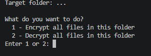

#  Folder Encryptor — AES-256-GCM

A lightweight console script that encrypts (or decrypts) **every file inside one fixed folder** — including all subfolders — using strong AES-256-GCM encryption. No GUI, no extra windows: just edit one line and run it.

##  Features

**AES-256-GCM** — authenticated encryption (protects against both reading *and* tampering)

**Password-based** — no key files to lose, the key is derived from your password every time

**Safe to re-run** — already-encrypted files are skipped when encrypting, already-decrypted files are skipped when decrypting

# Screenshot



##  Getting Started

### Requirements

- Python 3.8+
- [`cryptography`](https://pypi.org/project/cryptography/) library

### Installation

```bash
git clone https://github.com/yourusername/folder-encryptor.git
cd folder-encryptor
python -m pip install cryptography
```

### Setup

Open `folder_encryptor.py` and edit the `FOLDER_PATH` variable near the top to point at the folder you want to protect:

### Usage

```bash
python folder_encryptor.py
```

The script will ask whether to encrypt or decrypt, then prompt for a password (hidden as you type, never stored anywhere)
